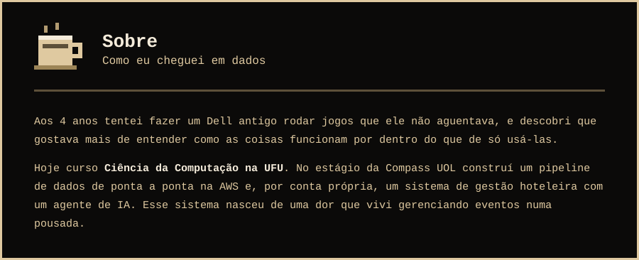
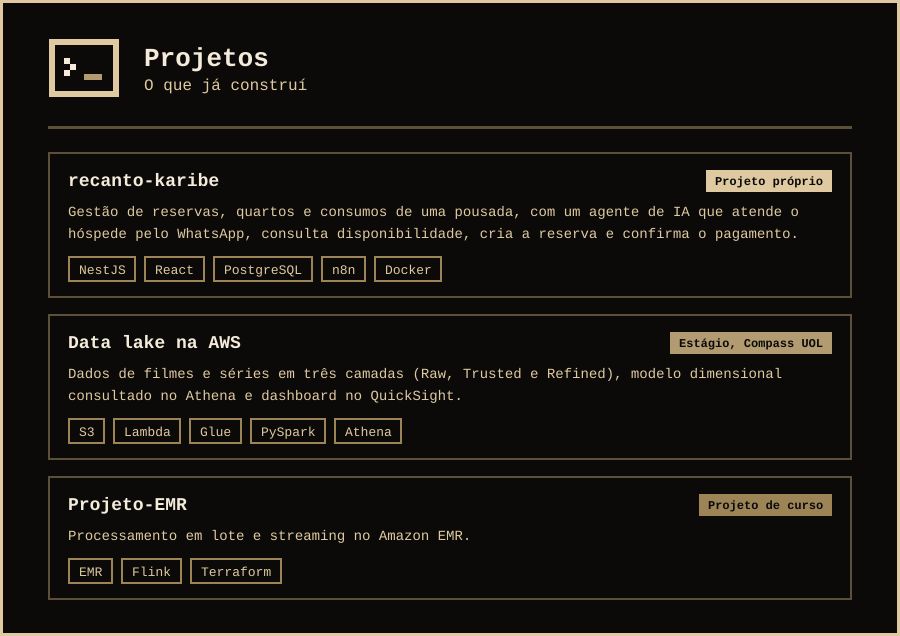
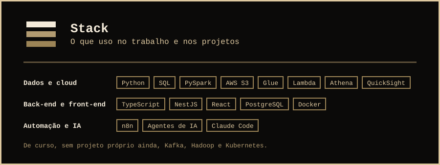
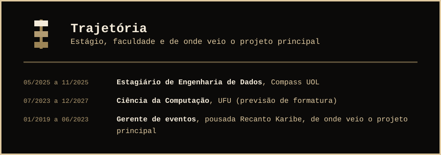
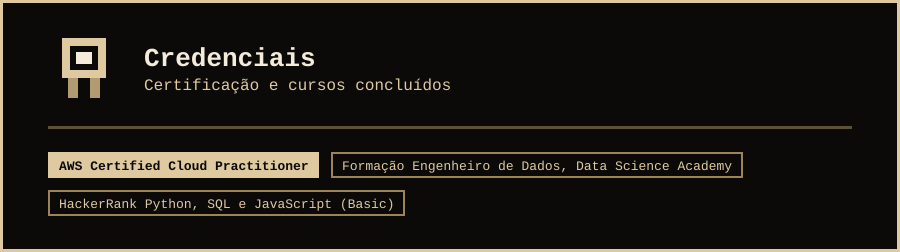

[recanto-karibe](https://github.com/Germalonso/recanto-karibe) · [Data lake na AWS](https://github.com/Germalonso/COMPASSUOL-AWS-DATA-ENGINEERING) · [Projeto-EMR](https://github.com/Germalonso/Projeto-EMR)

<picture>
  <source media="(prefers-color-scheme: dark)" srcset="https://raw.githubusercontent.com/Germalonso/Germalonso/output/github-snake-dark.svg">
  
</picture>

